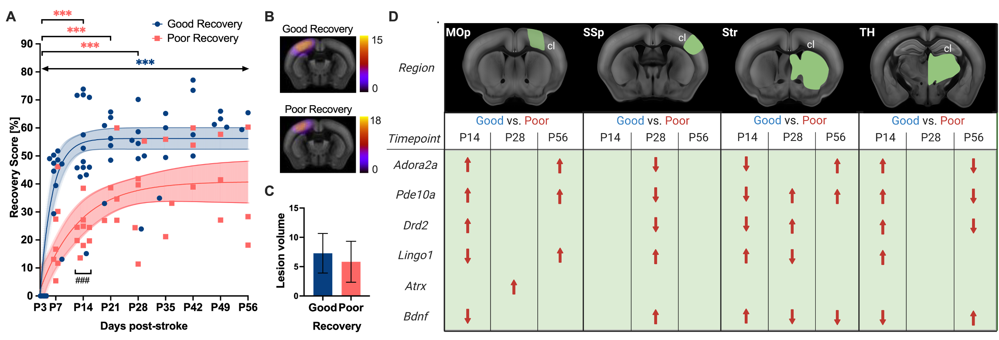
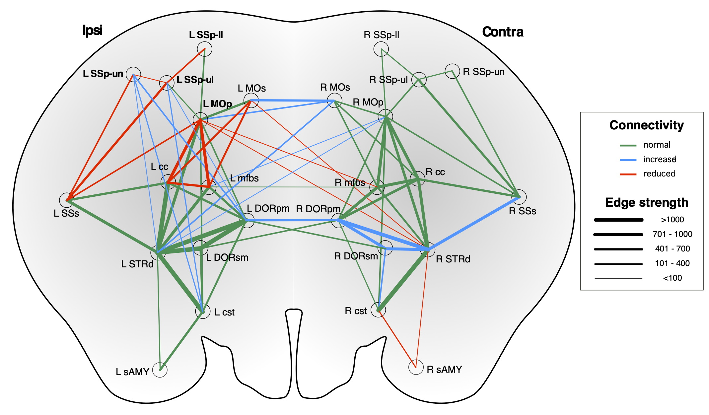

## Spontaneous recovery after stroke
Loss of function after stroke is caused by cell death and breakdown of the functional networks in the infarcted and connected brain regions. To some extent, the affected limb regains function, in a form of spontaneous recovery during the first 3 months after stroke. However, this recovery is generally incomplete and the underlying neural and molecular mechanisms are still unknown. In this project we are investigating brain/circuit activation patterns and analyse the transcriptome in the ipsi- and contralesional hemispheres of recovered vs. non-recovered mice after experimental stroke. 

On a molecular level, we have identified stroke recovery genes with region- and time-specific changes in gene expression related to spontaneous recovery after cortical stroke [Götz et al. Genes 2023](https://doi.org/10.3390/genes14020454): 

  

On a network level, we have mapped the dynamic changes in the sensorimotor network related to recovery after cortical stroke using DTI and graph theory [Pallast et al. Neuroimage 2021](https://doi.org/10.1016/j.neuroimage.2020.116873):

  

## Internal capsule stroke and spasticity after stroke in mice
Spasticity is a common symptom after stroke, arising in about 30% of patients, and affecting the lower as well as upper limb. The spastic (abnormal) muscle tone appears in the first weeks after stroke onset and maladaptive processes lead to a manifestation of spasticity, which ultimately limits the success of rehabilitation. While previous studies investigated the abnormal intra-spinal processing, spasticity remains a result of damage to the primary motor regions. Therefore we are characterizing the cellular components and network changes which lead to spasticity after stroke to effectively develop opposing optogenetic and chemogentic stimulation paradigms.

## Software and reproducible workflows

Explore our [AIDA imaging tools, tutorials, and FAIR data workflows]({{ '/software.html' | relative_url }}).
